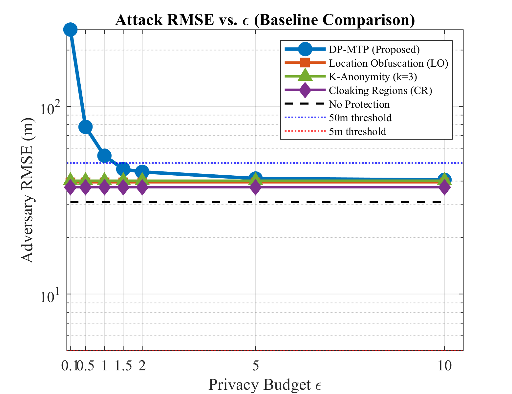
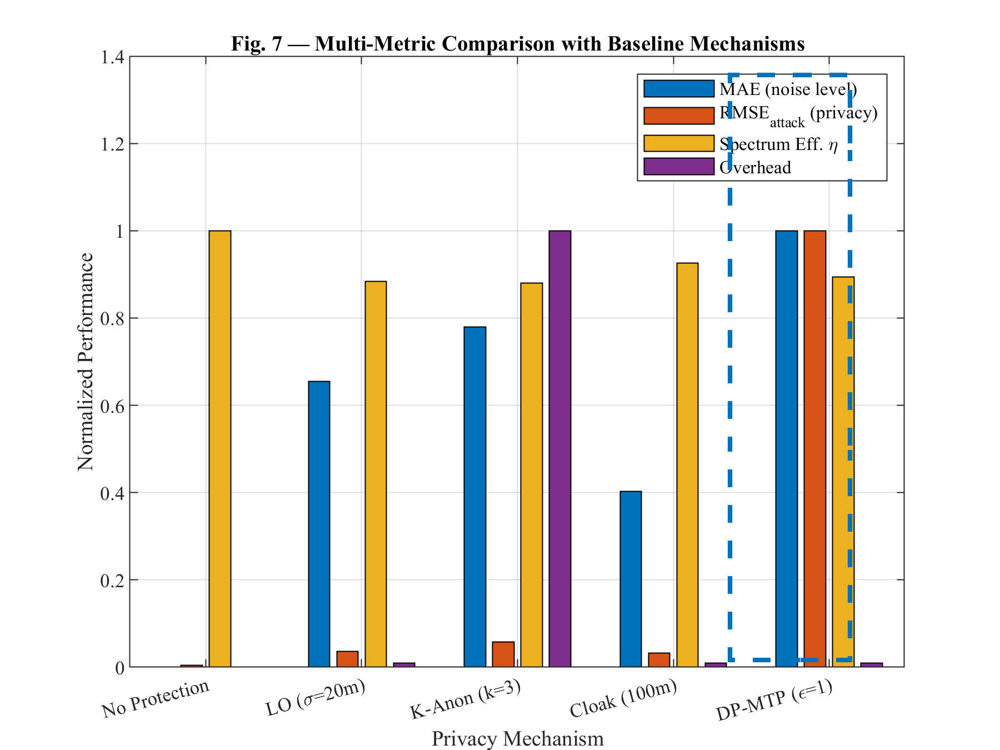

# Differential Privacy for Geo-Location Database Responses: Optimal Power Cost, Coalition Limits and Region Accounting

**Saman Zameni**
**Status:** In preparation

> [!IMPORTANT]
> **This is not the final code for this paper.** The repository contains a preliminary version of the simulation code. The final code used to produce the results reported in the paper will be released here once the paper is published.

## Abstract

Geo-location databases (GDBs) return maximum transmission power (MTP) limits that depend on the positions of protected primary users (PUs) and can therefore be exploited to localize them. We propose DP-MTP, a response-level differential-privacy mechanism for the interference-constrained MTP ceiling. Because the ceiling is Lipschitz with constant *L* = *αP*<sub>cap</sub>/*d*<sub>cap</sub>, Laplace noise of scale *LR*/*ε*, a public power backoff and clipping give *ε*-differential privacy for PU displacements of up to *R* metres while bounding the probability *p* of exceeding the ceiling. We prove that no translation-invariant metric-private release with the same *p* loses less power, up to 8.5% at *p* = 1%; derive Van Trees and Le Cam bounds on the accuracy of any coalition of querying devices; and introduce a public per-cell privacy ledger that bounds the per-PU loss in each epoch for any coalition size while serving exhausted cells from one cached conservative release. With exact-likelihood attackers, a single response at *ε* = 1 and *R* = 1 m raises the distance error of informative queries from essentially zero to 13.3 m while retaining 91.5% of the allowable power. Adaptive coalitions of 200 queries, however, localize a PU to 0.28 m, within a factor of two of the Van Trees bound, and invert cloaking, sybil-assisted *k*-anonymity and coarsening to the 0.1 m resolution of the estimator. The ledger stops this decrease at 2.0 m, and larger *R* raises the error floor to 5 m at 63% and 14 m at 38% retained power. Correlated 8 dB shadowing raises the required noise 8.4-fold.

**Keywords:** Differential Privacy, Geo-location Database, Cognitive Radio, Spectrum Sharing, Location Privacy, Maximum Transmission Power

## Repository contents

| File | Purpose |
|---|---|
| `DP_MTP_AllFigures.m` | Main script: sets the parameters, runs all experiments and saves the figures |
| `run_mc.m` | Monte Carlo simulation of the DP-MTP mechanism (noise error, retained power, attack RMSE) |
| `run_baselines.m` | Baseline privacy mechanisms simulated for comparison with DP-MTP |
| `particle_attack.m` | Particle/importance-sampling attack used to estimate PU distance from noisy responses |
| `Fig*.png` | Figures produced by the main script |

## How to run

Requires MATLAB (R2021a or later) with the Statistics and Machine Learning Toolbox.

```matlab
DP_MTP_AllFigures   % runs run_mc, run_baselines and particle_attack, then saves Fig1–Fig7 (rng seed 42)
```

## Example outputs (preliminary code)

| Attack RMSE vs. ε | Comparison with baselines |
|---|---|
|  |  |

These figures come from this preliminary version and may differ from the figures in the paper.

## Contact

Saman Zameni · [Website](https://samanzameni.netlify.app) · [ORCID](https://orcid.org/0009-0006-8774-6391) · [saman.zameni@gmail.com](mailto:saman.zameni@gmail.com)
